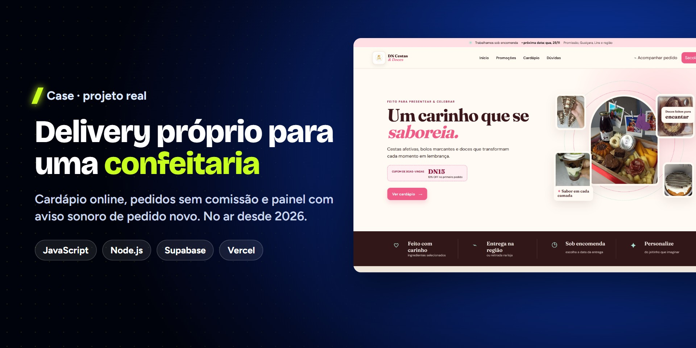
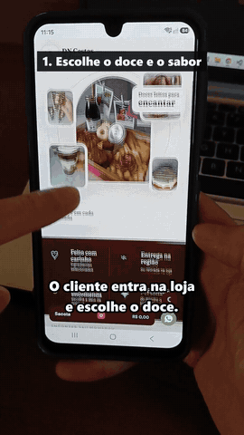
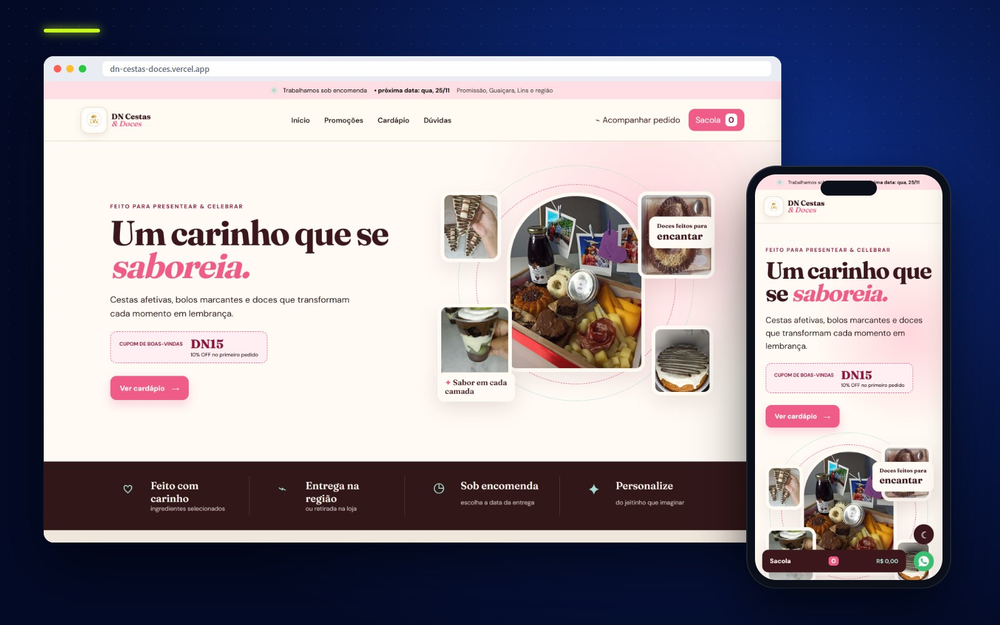
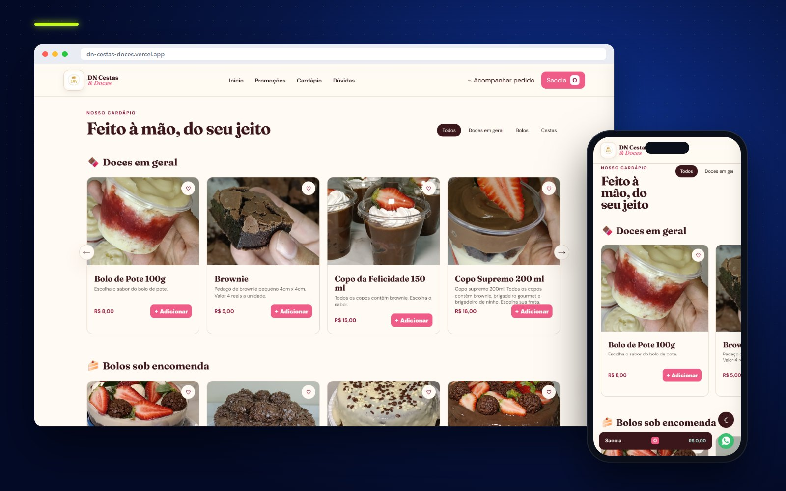
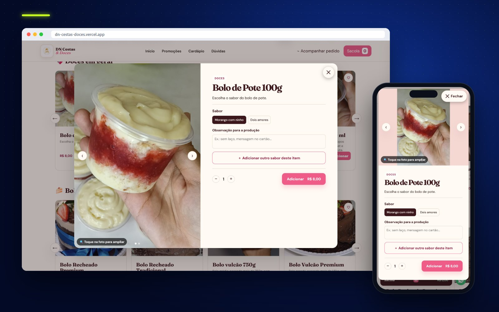
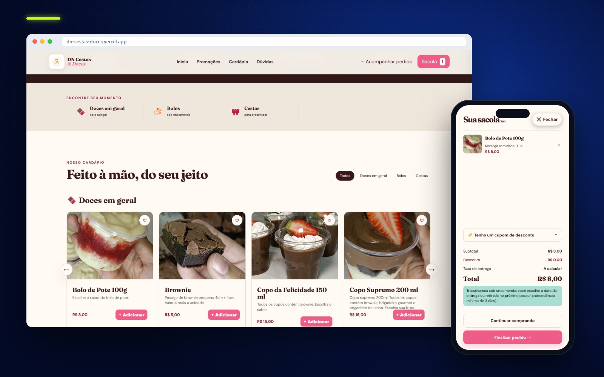
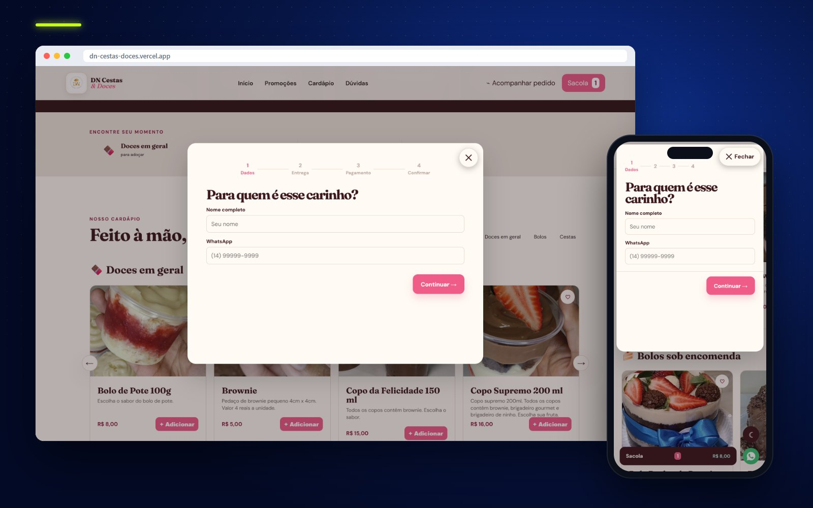
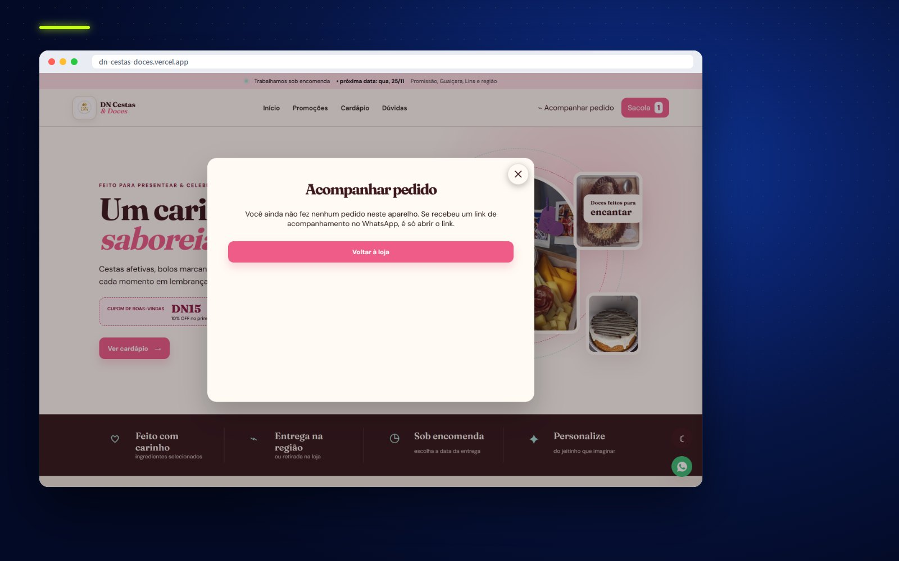
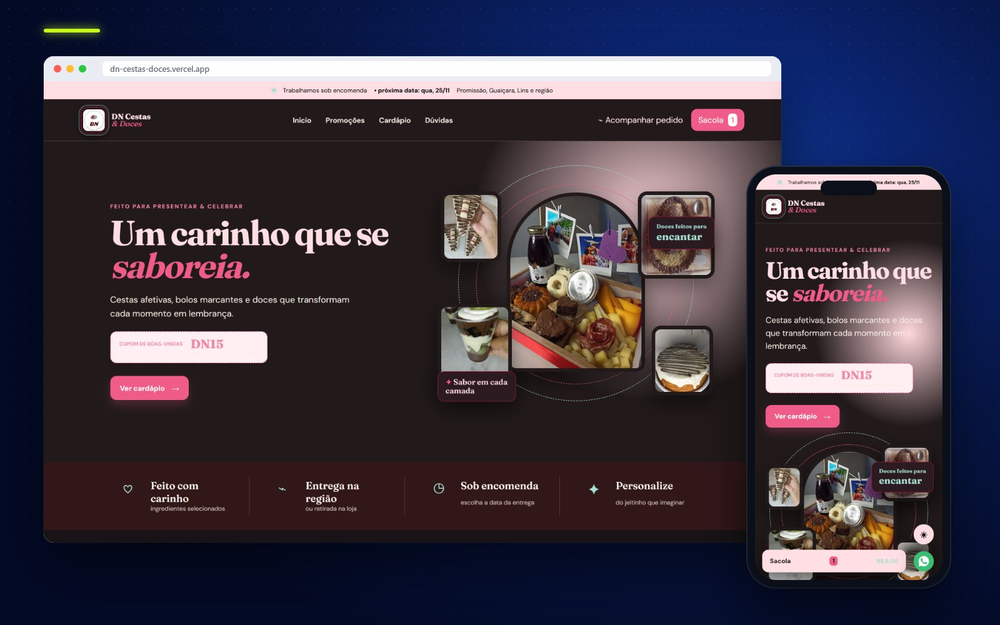

  

  
  
  

> **Sobre este case:** a DN Cestas & Doces é uma confeitaria real de Promissão/SP, e o sistema está **no ar e recebendo pedidos**. Aqui estão as telas e as decisões do projeto. O **código é privado**, porque tem o banco de dados e os dados dos clientes da loja.

---

## O problema

A confeitaria vendia **só pelo WhatsApp e pelo Instagram**:

- Cada pedido virava uma conversa longa: qual sabor, quanto custa, tem para amanhã, como paga.
- Os pedidos ficavam espalhados nas mensagens, e era fácil esquecer algum.
- Os aplicativos de delivery cobram **comissão por pedido**, o que pesa no preço de um doce artesanal.

## A solução

Um **delivery próprio**, com a cara da marca: o cliente monta o pedido sozinho, escolhe a data e paga, e a dona recebe tudo organizado em um painel, **sem pagar comissão**.

   
  Vídeo real: o pedido feito no celular e chegando no painel da loja.

---

## A loja, tela por tela

### 1. Página inicial

- Fotos reais dos produtos, cores da marca e **cupom de boas-vindas** logo na abertura.
- Faixa no topo avisa que a loja trabalha **sob encomenda** e mostra a próxima data disponível.
- Botões fixos do **WhatsApp** e da **sacola**, sempre à mão no celular.

### 2. Cardápio

- Produtos separados por categoria (doces, bolos e cestas), com **filtro** e carrossel.
- Preço e botão "Adicionar" em cada card.

### 3. Escolha do produto

- Galeria de fotos com **toque para ampliar**.
- Escolha de **sabor**, campo de **observação para a produção** (ex.: mensagem no cartão) e opção de **adicionar outro sabor** do mesmo item.

### 4. Sacola

- Resumo do pedido com **cupom de desconto**, taxa de entrega e total.
- Aviso de que a loja trabalha **sob encomenda**, com a antecedência mínima.

### 5. Finalizar o pedido em 4 passos

1. Dados do cliente.
2. **Entrega ou retirada** e a **data** no calendário.
3. Pagamento, inclusive **Pix**.
4. Confirmação. O pedido chega **pronto no WhatsApp** da loja.

### 6. Acompanhar pedido

- O cliente acompanha a situação do pedido pelo link que recebe no WhatsApp, sem precisar perguntar "já saiu?".

### 7. Modo escuro

- Um toque troca para o tema escuro, mantendo a identidade da marca.

---

## O painel da loja

Área só da dona, com login. Por segurança, ela **não aparece em prints aqui**, mas você vê o painel funcionando no vídeo acima.

| Seção | O que faz |
|---|---|
| **Pedidos** | Quadro com os pedidos por etapa (novos, confirmados, em preparação, em entrega) e **aviso sonoro** quando chega pedido novo. |
| **Agenda de entregas** | Mostra o que precisa ficar pronto em cada dia. |
| **Produtos, categorias e adicionais** | Cadastro com foto, preço e sabores. O que muda no painel **aparece na loja na hora**. |
| **Cupons** | Cria cupons de desconto, como o de boas-vindas. |
| **Áreas de entrega** | Bairros e cidades atendidos, cada um com a sua taxa. |
| **Banners e promoções** | Destaques que aparecem na loja. |
| **Abrir e fechar a loja** | Um botão pausa os pedidos, e a loja avisa o cliente. |

## Destaques técnicos

| | |
|---|---|
| **Zero comissão** | O pedido vai direto para a loja, sem intermediário. |
| **Atualização em tempo real** | Preço, foto, produto esgotado e loja pausada aparecem para o cliente sem recarregar a página. |
| **Segurança** | Senhas criptografadas, limite de tentativas de login, regras de acesso no banco de dados e monitoramento de erros. |
| **Feito para o celular** | Quase todos os pedidos vêm do celular. A loja foi desenhada primeiro para ele. |

## Tecnologias

  
  
  
  
  
  
  
  

## O que é público e o que é sigiloso

| Público neste repositório | Fica privado |
|---|---|
| Telas da loja, fluxo de compra, funcionalidades e o vídeo real | Código-fonte, banco de dados, pedidos, dados dos clientes e o acesso ao painel |

---

  <b>Quer um delivery próprio, sem comissão, para o seu negócio?</b> 
  Eu sou o Danilo, da <b>TechSolution</b>. Crio sites, sistemas e aplicativos sob medida.  
  <a href="https://www.instagram.com/__techsolution__"><b>Siga @__techsolution__ no Instagram</b></a> para ver mais projetos e bastidores ·
  <a href="https://wa.me/5514991556986">WhatsApp</a> ·
  <a href="https://techsolution-links.vercel.app">Site</a>

